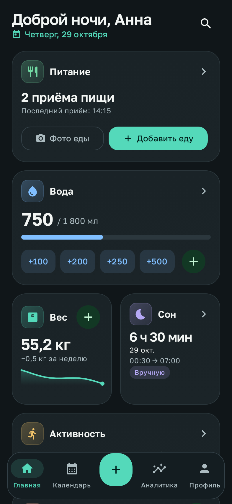
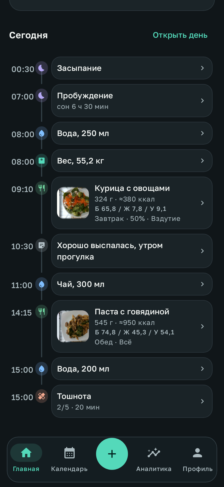
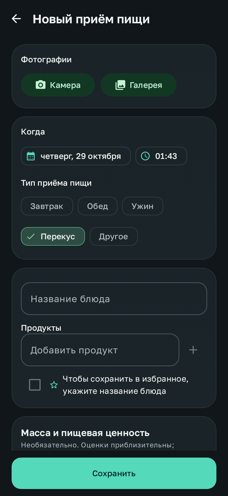
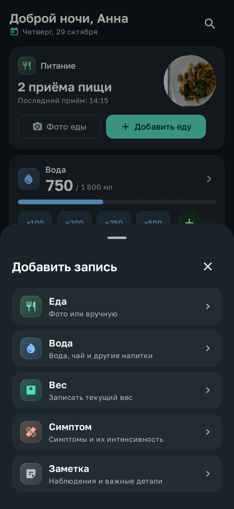
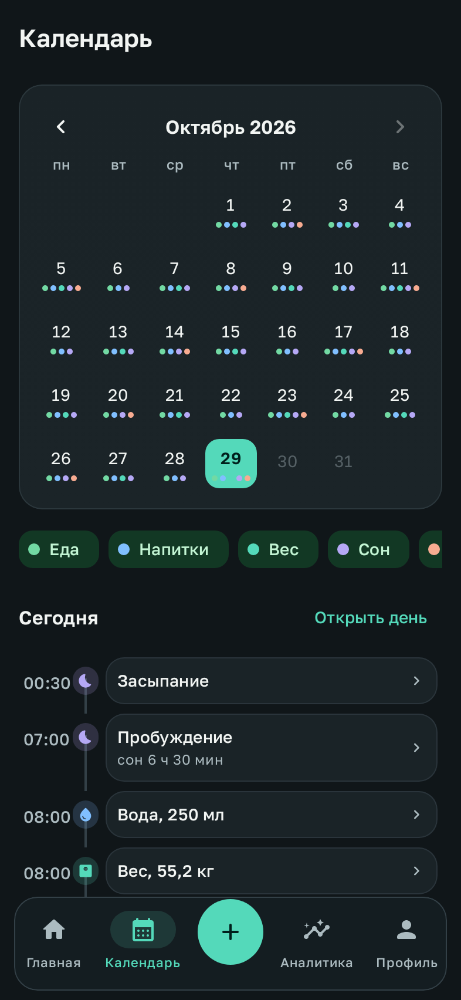
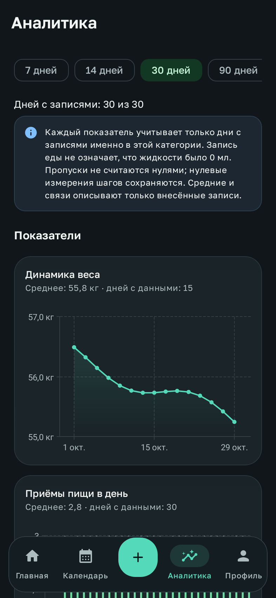
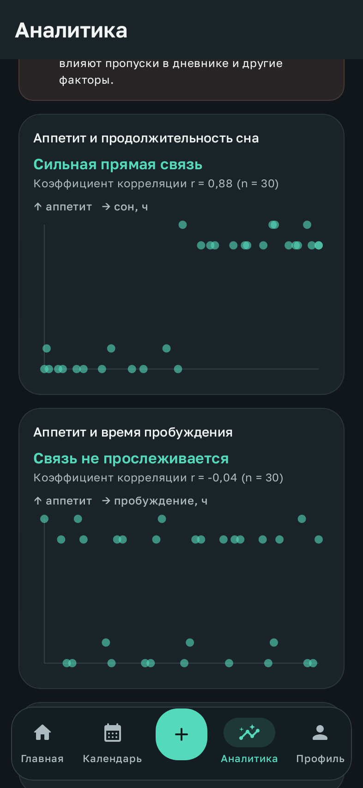
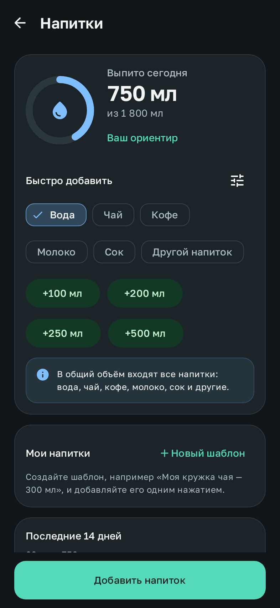
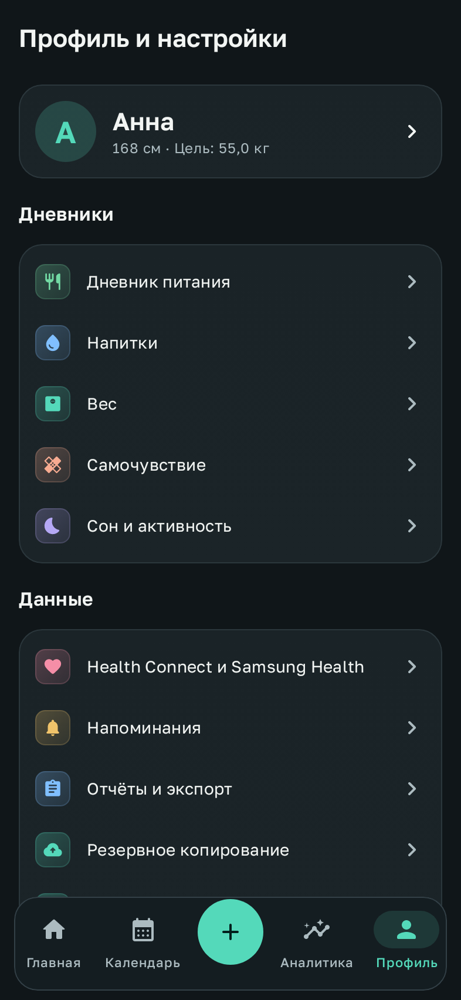

# NUTRIX — Personal Health Tracker

Нативное Android-приложение для личного дневника питания, жидкости, веса, сна, активности и
самочувствия. Kotlin + Jetpack Compose + Material 3. Дневник и локальные подсказки работают офлайн;
записи хранятся на устройстве. Необязательное распознавание еды Gemini отправляет выбранное
фото Google только по вашей кнопке и с вашим API-ключом. Наблюдения о режиме питания, сна и напитков,
обзор за 4 недели и адаптивные напоминания считаются на устройстве; необязательный облачный разбор 4 недель
доступен только для ключа из платного Cloud-проекта и отправляет Gemini только числа. Импорт данных из Health Connect и (опционально) напрямую из Samsung Health через
официальный Samsung Health Data SDK.

> NUTRIX — дневник, а не медицинское изделие. Приложение не ставит диагнозов и не делает выводов о
> причинах: графики и коэффициенты корреляции показывают только совпадения в ваших записях.

| Главная | Хронология дня | Новый приём пищи |
|---|---|---|
|  |  |  |
| **Быстрое добавление** | **Календарь** | **Аналитика** |
|  |  |  |
| **Связи между показателями** | **Напитки** | **Профиль и настройки** |
|  |  |  |

Скриншоты — это настоящий UI приложения, отрисованный тестом `ScreenshotTest` (Robolectric, нативная
графика) на демонстрационных данных, а не макеты. С физического устройства они не снимались.

Визуальная система, адаптивная компоновка, редактирование массы/ккал/БЖУ и исправление возврата
фото камеры описаны в [docs/ui-refresh.md](docs/ui-refresh.md). Шрифт Golos Text включён в приложение по SIL OFL.
Анимации переходов, отклик на касания, эффекты воды и смахивание для удаления описаны в
[docs/motion.md](docs/motion.md).

Повторная сверка компоновки по всем 15 листам и исправленные расхождения описаны в
[docs/reference-alignment.md](docs/reference-alignment.md). В `docs/screenshots/` — 49 нативных кадров,
включая редакторы, контекстные действия, ошибки и состояния Gemini. Тестовые фото Nutrition5k
используются по CC BY 4.0; [атрибуция](app/src/test/resources/photos/ATTRIBUTION.md). В APK эти тестовые файлы не включаются.

---

## Содержание

1. [Готовый APK и установка на Samsung Galaxy](#1-готовый-apk-и-установка-на-samsung-galaxy)
2. [Первый запуск и подключение данных](#2-первый-запуск-и-подключение-данных)
3. [Сборка из исходников](#3-сборка-из-исходников)
4. [Структура проекта](#4-структура-проекта)
5. [Реализованные функции](#5-реализованные-функции)
6. [Health Connect](#6-health-connect)
7. [Samsung Health: возможности и ограничения](#7-samsung-health-возможности-и-ограничения)
8. [Конфиденциальность и безопасность](#8-конфиденциальность-и-безопасность)
9. [Тестирование и что проверено](#9-тестирование-и-что-проверено)
10. [Известные ограничения](#10-известные-ограничения)
11. [Сторонние компоненты и лицензии](#11-сторонние-компоненты-и-лицензии)

---

## 1. Готовый APK и установка на Samsung Galaxy

**[Скачать актуальный APK](https://github.com/Malikk-Sh/Nutrix/releases/latest/download/NUTRIX.apk)**
или открыть [страницу релиза](https://github.com/Malikk-Sh/Nutrix/releases/latest).
Версия 1.7.0 показывает, что именно изменилось за 4 недели в числах и какие границы правил сдвинулись,
открывает обе группы сравнения у каждого сочетания с переходом к конкретной записи и передаёт облачному
разбору готовые разницы вместо слов ([подробнее](docs/insights.md)). В 1.6.0 — сравнение с предыдущими
4 неделями, дни наблюдения и выбранные темы; ключ из платного проекта можно отметить в настройках Gemini.
В 1.5.0 — напоминания по вашему распорядку и вопрос о самочувствии после еды
([подробнее](docs/reminders.md)); ранее — наблюдения о режиме, обновлённый интерфейс с анимациями,
распознавание еды Gemini и автозаполнение массы, ккал и БЖУ.
Оптимизированная personal-сборка подписана прежним ключом для обновления установленного приложения
(≈9 МБ, minSdk 29 / Android 10+, targetSdk 36). Контрольная сумма опубликована в релизе.

Требования: Android 10 или новее (на Galaxy — One UI 2 и новее).

1. Скачайте `NUTRIX.apk` на телефон по ссылке выше,
   либо скопируйте его с компьютера по USB.
2. Если включён **Автоблокировщик** (One UI 6+: *Настройки → Безопасность и конфиденциальность →
   Автоблокировщик*), временно выключите его — иначе установка APK не из Galaxy Store / Google Play
   будет заблокирована. После установки его можно включить обратно.
3. Откройте APK из *Моих файлов* или из уведомления браузера. При запросе разрешите
   «Установка неизвестных приложений» для этого источника.
4. Google Play Защита может показать предупреждение о неизвестном разработчике (APK подписан
   debug-ключом) — выберите *Подробнее → Всё равно установить*.
5. Повторные сборки подписаны тем же ключом (`app/debug.keystore`), поэтому устанавливаются
   поверх без потери данных.

Через компьютер: `adb install -r NUTRIX.apk` или `./gradlew installPersonal`
(на телефоне должна быть включена отладка по USB).

## 2. Первый запуск и подключение данных

1. **Профиль** (вкладка *Профиль*) — имя, рост, вес, цель по весу. Всё необязательно.
2. **Ориентир по жидкости** задаётся вручную на экране *Напитки* — приложение не навязывает «норму».
3. **Health Connect**: *Профиль → Health Connect и Samsung Health → Подключить*. Откроется системный
   экран разрешений; NUTRIX запрашивает только чтение (шаги, сон, пульс, вес, тренировки, калории,
   фоновое чтение, история). На Android 14+ Health Connect встроен в систему, на Android 10–13 его
   нужно установить из Google Play.
4. Чтобы данные Samsung Health попадали в Health Connect: *Samsung Health → ⋮ → Настройки →
   Health Connect* → разрешить запись нужных категорий. Это основной и рекомендуемый путь на Galaxy.
5. **Прямое подключение Samsung Health** (опционально) — см. [раздел 7](#7-samsung-health-возможности-и-ограничения).
6. **Напоминания** (*Профиль → Напоминания*) выключены по умолчанию; при включении Android 13+
   спросит разрешение на уведомления.
7. **Защита** (*Профиль → Защита приложения*): PIN-код, разблокировка по биометрии, скрытие
   содержимого в списке недавних приложений.

## 3. Сборка из исходников

Требования:

- JDK 17 или новее (проверено на JDK 21);
- Android SDK: Platform 36 и Build-Tools (Android Studio установит сам);
- путь к SDK в `ANDROID_HOME` или в `local.properties` (`sdk.dir=/путь/к/Android/sdk`);
- интернет при первой сборке (Gradle скачивает зависимости).

```bash
./gradlew assembleDebug          # APK: app/build/outputs/apk/debug/app-debug.apk
./gradlew installDebug           # установить на подключённый телефон
./gradlew testDebugUnitTest      # все тесты (JVM + Robolectric), ~1–2 мин
./gradlew assembleRelease        # R8-сборка; без закрытого ключа результат НЕ подписан
./gradlew assemblePersonal       # R8-сборка для личной установки, с прежним debug-ключом
```

В Android Studio: *File → Open* → папка проекта → дождаться Gradle Sync → *Run ▶*.

Используемые версии: AGP 8.13.2, Gradle 8.14.3, Kotlin 2.2.21, Compose BOM 2025.12.01,
Room 2.8.4, Hilt 2.57.2, Navigation 2.9.6, WorkManager 2.10.5, CameraX 1.5.1,
Health Connect 1.1.0, Glance 1.1.1, Vico 2.1.4, Coil 3.3.0 (полный список —
`gradle/libs.versions.toml`).

### Samsung Health Data SDK в сборке

SDK не публикуется в Maven, поэтому подключается файлом:
`app/libs/samsung-health-data-api-1.1.0.aar` (уже лежит в репозитории, взят из
`samsung-health-data-sdk-1.1.0.zip`). Gradle выбирает реализацию автоматически:

- AAR есть → компилируется `app/src/samsungSdk/` (настоящий адаптер), `BuildConfig.SAMSUNG_SDK_BUNDLED = true`;
- AAR нет → `app/src/samsungStub/` (заглушка, экран интеграций честно пишет, что SDK не включён),
  всё остальное, включая Health Connect, работает.

Удалить SDK из сборки = удалить AAR из `app/libs/`.

### Нюансы окружения

- Robolectric при первом запуске тестов скачивает `android-all` для SDK 34. Если Maven Central
  недоступен, можно указать зеркало: `./gradlew testDebugUnitTest -ProbolectricRepoUrl=<url>`.
- Для тестов нужен heap 3 ГБ (`maxHeapSize` уже задан в `app/build.gradle.kts`).


### Подпись и проверка изменений

`release` больше не использует публичный debug-ключ. Для подписи задайте через окружение
`NUTRIX_KEYSTORE_PATH`, `NUTRIX_KEYSTORE_PASSWORD`, `NUTRIX_KEY_ALIAS`, `NUTRIX_KEY_PASSWORD`.
Храните keystore за пределами репозитория. При отсутствии всех четырёх переменных release APK
остаётся неподписанным; при неполной конфигурации сборка останавливается.

Для личного обновления поверх прежнего APK используйте `./gradlew assemblePersonal`
(`app/build/outputs/apk/personal/app-personal.apk`). Этот вариант явно использует прежний публичный
ключ и не предназначен для подтверждения авторства публичных обновлений. Подписанный новым
закрытым ключом APK нельзя установить поверх старого debug APK: сначала сохраните и проверьте
резервную копию, затем спланируйте перенос, чтобы не потерять дневник.

GitHub Actions запускает тесты, lint и сборки release/personal для pull request и основной ветки.
Установочный APK с прежней подписью доступен в артефакте `nutrix-personal-apk` завершённого запуска Actions.
Ошибки lint теперь останавливают сборку. Протокол восстановления и ограничения проверок описаны
в [docs/data-safety.md](docs/data-safety.md).

## 4. Структура проекта

Один Gradle-модуль `app` с модульной структурой пакетов: каждая область ТЗ — отдельный пакет
со своими слоями. Это упрощает сборку и не мешает потом вынести пакеты в Gradle-модули
(зависимости направлены `feature → data/domain → database/core`).

```
app/src/main/kotlin/com/nutrix/app/
├── NutrixApp.kt, AppStartup.kt      Application, Hilt, WorkManager, планирование фоновых задач
├── MainActivity.kt                  единственная Activity, блокировка, snackbar/undo, deep-link действия
├── navigation/                      типобезопасные маршруты, NavHost, нижняя панель / rail, FAB «быстрое добавление»
├── core/
│   ├── model/                       перечисления предметной области (тип приёма пищи, симптомы, источники…)
│   ├── time/                        модель времени записи (момент + часовой пояс + локальная дата), форматирование
│   ├── datastore/                   настройки (DataStore), состояние синхронизации, зашифрованные секреты
│   ├── security/                    Android Keystore (AES-GCM), PBKDF2 для PIN, менеджер блокировки
│   ├── photo/                       хранение фото: импорт, EXIF-поворот, сжатие, кадрирование, очистка сирот
│   ├── util/                        единицы измерения
│   └── ui/                          тема (тёмная по умолчанию), компоненты, графики (Vico), иконки
├── database/                        Room: сущности, DAO, конвертеры (схема — app/schemas/)
├── domain/                          чистая логика: дедупликация веса/сна/активности, аналитика, корреляции
├── data/repository/                 репозитории, хронология дня, undo, уведомление виджетов
├── feature/
│   ├── dashboard/                   главный экран
│   ├── food/                        дневник питания, редактор, камера, кадрирование, избранное, черновики
│   ├── water/                       напитки, шаблоны, быстрые объёмы
│   ├── weight/                      вес, статистика, график
│   ├── symptoms/                    самочувствие
│   ├── activity/                    сон и активность
│   ├── notes/                       заметки
│   ├── calendar/                    календарь, экран дня, хронология, фильтры
│   ├── analytics/                   аналитика, сравнения, корреляции
│   ├── search/                      поиск
│   ├── reports/                     PDF / CSV / JSON, режим «для врача»
│   ├── settings/                    профиль, настройки, «удалить всё», о приложении
│   ├── lock/                        экран блокировки (PIN + биометрия)
│   └── ai/                          локальные подсказки, справочник и необязательный Gemini-клиент
├── integration/
│   ├── healthconnect/               клиент Health Connect, синхронизация (Changes API), privacy policy activity
│   ├── samsung/                     интерфейс шлюза Samsung Health, синхронизация
│   └── sync/                        общий импорт, дедупликация, приоритет источников, WorkManager
├── reminders/                       планировщик, распорядок для адаптивных напоминаний, тихие часы, уведомления с действиями
├── backup/                          резервные копии ZIP (AES-256), проверка целостности, автокопии
└── widget/                          4 виджета (Glance)

app/src/samsungSdk/kotlin/…          адаптер Samsung Health Data SDK (компилируется, если есть AAR)
app/src/samsungStub/kotlin/…         заглушка без SDK
app/src/test/kotlin/…                тесты (см. раздел 9)
app/src/main/res/values/strings_*.xml  все тексты интерфейса (русский), разбиты по разделам
```

Архитектура: MVVM + однонаправленный поток данных. Экран → `ViewModel` (`StateFlow`) →
репозиторий → Room/DataStore. Зависимости — Hilt. Фоновые задачи (синхронизация, напоминания,
автокопии, очистка) — WorkManager.

## 5. Реализованные функции

**Главная**
- приветствие по времени суток, дата, сводка дня;
- карточки: питание (фото еды / добавить), вода (прогресс к вашему ориентиру и быстрые объёмы),
  вес (последнее значение, изменение за неделю, мини-график), сон, активность (шаги, пульс,
  тренировки с указанием источника), самочувствие;
- хронология сегодняшнего дня; адаптивная сетка карточек на планшетах и складных устройствах.

**Питание**
- фото с камеры (CameraX: вспышка, переключение камеры) и из галереи (Photo Picker, без доступа ко всей памяти), несколько фото;
- просмотр с масштабированием, кадрирование с поворотом, выбор обложки, удаление;
- дата и время подставляются автоматически, часовой пояс сохраняется вместе с записью;
- тип приёма пищи (подсказывается по времени), название, список продуктов;
- аппетит 0–5, съеденная порция, насыщение, несколько ощущений после еды;
- вес «на момент приёма» — отдельная измерение веса создаётся только после явного подтверждения;
- заметка, примерная калорийность по встроенному справочнику (явно помечена как оценка);
- быстрое сохранение: достаточно фото, время ставится автоматически;
- избранное (шаблоны блюд), автосохранение черновика через 500 мс после изменения и при сворачивании,
  восстановление новых записей и правок существующих записей, предупреждение при выходе без сохранения;
- удаление с подтверждением и отменой (Undo).

**Напитки**: вода, чай, кофе, молоко, сок, другое; все входят в общий объём; свои шаблоны
(«моя кружка — 300 мл»); настраиваемые кнопки быстрых объёмов; ориентир задаёт пользователь,
автоматической «нормы» нет; график за 14 дней.

**Вес**: кг/фунты, статистика (мин/макс/среднее, изменение за период), график, цель; записи из
Health Connect / Samsung Health с указанием источника; дедупликация одинаковых измерений из
разных источников; предупреждение о вероятном дубле при ручном вводе.

**Самочувствие**: 12 симптомов (тошнота, головокружение, потемнение в глазах, слабость, боль в
животе, быстрое насыщение, отрыжка, вздутие, сердцебиение, дрожь, потливость, другое),
интенсивность, длительность, связь с приёмом пищи, положение тела, запись в одно касание.
Осторожные подсказки обратиться к врачу при сильных симптомах — без диагнозов.

**Сон и активность**: сон из Health Connect / Samsung Health или вручную, включая несколько сессий за сутки.
Ночной сон и дневные/вечерние сессии видны в календаре, списке, главной карточке, аналитике и отчётах;
пересекающиеся интервалы не увеличивают общую длительность дважды. Также доступны шаги, пульс, калории,
тренировки по дням с источником.

**Календарь**: месяц с цветными индикаторами категорий, фильтры, экран дня с полной хронологией
(еда, напитки, вес, симптомы, засыпание/пробуждение, тренировки, заметки). Время в другом часовом
поясе показывается с указанием GMT-смещения.

**Аналитика**: периоды 7/14/30/90 дней и произвольный; 10 графиков — вес, количество приёмов
пищи, жидкость, аппетит, быстрое насыщение, тошнота, продолжительность сна, время засыпания,
шаги, пульс;
сравнение с предыдущим периодом; связи между показателями (коэффициент Пирсона с оценкой силы и
диаграммой рассеяния). Пропуски учитываются отдельно для каждого показателя и не считаются «нулевыми»; при недостатке данных
показывается предупреждение, а не график. Формулировки — только «совпадение», не «причина».

**Поиск** по названиям блюд, продуктам, заметкам, симптомам и датам («12 марта», «12.03»).

**Напоминания**: еда, вода, вес, самочувствие, пропущенные записи; фиксированное время или
интервал; дни недели; тихие часы; «отложить»; «+250 мл» прямо из уведомления; нейтральные тексты
без давления. Еда, вода и вес могут подстраиваться под распорядок, выученный на устройстве за 4 недели:
напоминание о еде приходит, только если обычный приём ещё не записан, о воде — только при заметном
отставании от вашего темпа. После трёх напоминаний подряд без ответа они приходят не чаще раза в день.
Необязательный вопрос «Как прошла еда?» с ответами «Нормально», «Отметить» и «Не помню» — не чаще
раза в день; пропуск не считается «нормально». [Правила и пороги](docs/reminders.md).
Работают через WorkManager, переживают перезагрузку.

**Отчёты**: PDF (обычный и «для врача» — сжатая сводка за период, симптомы, вес с графиком),
CSV (одним файлом событий или ZIP-архивом таблиц, UTF-8 с BOM для Excel), JSON; опционально с
фотографиями; сохранение через системный диалог или «Поделиться».

**Резервное копирование**: ZIP с базой, настройками и фото; опциональное шифрование паролем
(AES-256); `manifest.json` с SHA-256 каждого файла; проверка целостности SQLite, Room-схемы, настроек и наличия фото перед
восстановлением; транзакционная замена записей и журнал отката фото/настроек; автоматические копии в выбранную папку с ротацией.

**Прочее**: быстрое добавление (FAB) отовсюду; 4 виджета — «Вода» (+250 мл в одно касание),
«Вес», «Еда» (открывает камеру), «Сегодня»; тёмная (по умолчанию), светлая и системная тема;
удаление всех данных с подтверждением словом; PIN и биометрия; доступность (описания для
TalkBack, крупный шрифт, маленькие экраны проверены тестом).

**ИИ по фото**: выбранный снимок и подсказка отправляются Google Gemini по кнопке. Результат
содержит блюдо, продукты, массу порции, ккал и БЖУ на порцию / 100 г и автоматически заполняет
редактируемые поля. Сохранение дневника выполняется отдельной кнопкой; все значения можно
исправить вручную, в том числе во время ожидания ответа. Загрузка показывает номер попытки
и позволяет отменить запрос. Временный сетевой сбой, таймаут или ошибка сервиса повторяются
один раз; после ошибки доступна кнопка «Повторить». Ошибки ключа и квоты автоматически не
повторяются. Ключ вводится в настройках Gemini и хранится
в Android Keystore-зашифрованном виде, без включения в APK или копии.
[Настройка ключа и среды для проверки](docs/gemini-food.md).

**Наблюдения и разбор 4 недель**: раздел «Аналитика → Наблюдения» и карточка на главной показывают
режим питания, поздние приёмы пищи, длинные перерывы, калории по оценкам, напитки и ваш ориентир,
кофе после 16:00 и сон, режим сна, тенденцию веса и шаги — в сравнении с вашими же днями за 4 недели,
со счётчиками дней и без общих «норм». Самочувствие после больших порций и слабость после длинных
перерывов показываются только при достаточном числе эпизодов. Каждое наблюдение сравнивается с предыдущими
4 неделями («Повторяется», «Новое», «Изменилось», «Пока не повторилось»), а «Показать дни» открывает дни,
по которым посчитано сочетание. Выбранные темы показываются первыми. Обзор за 4 недели без интернета выделяет до трёх
наблюдений, главное ограничение данных и одно действие в дневнике. Для ключа из платного Cloud-проекта
Gemini по кнопке и после согласия пишет короткий разбор только по числам этих карточек; с бесплатным
ключом наблюдения не отправляются. [Правила, пороги и что отправляется](docs/insights.md).
Вместо этого работают локальные подсказки (по вашей истории и времени суток) и приблизительная
оценка калорий по справочнику ~70 блюд. Всё считается на устройстве.

## 6. Health Connect

- Только **чтение**: шаги, сон, пульс, вес, тренировки, активные и общие калории, фоновое чтение,
  история старше 30 дней. Разрешения на запись не запрашиваются — NUTRIX ничего не записывает
  обратно.
- Экран статуса: доступность Health Connect, выданные разрешения по каждой категории, время
  последней синхронизации, ошибки, число импортированных записей.
- Первичный импорт — 30 дней (365 при разрешении на историю); дальше — инкрементально через
  Changes API (токены по каждому типу), поэтому изменения и удаления в источнике тоже применяются.
- Ручная синхронизация и периодическая (каждые 1–24 ч, WorkManager).
- Дедупликация: один и тот же вес, сон и тренировка из Health Connect и Samsung Health показываются один раз;
  приоритет источников настраивается; ручные записи всегда главнее.
- Отзыв разрешений обрабатывается (статус «разрешение отозвано», без падений).
- При отключении источника можно удалить импортированные из него данные (ручные записи не трогаются).

## 7. Samsung Health: возможности и ограничения

Используется только официальный **Samsung Health Data SDK 1.1.0** (`com.samsung.android.sdk.health.data`).
Устаревший Samsung Health SDK for Android не используется, неофициальных способов доступа нет.

Что читается: шаги, сон, пульс, вес (состав тела), тренировки, сводка активности (калории).

**Ограничения:**

1. **Партнёрство Samsung.** Без одобрения в программе партнёров Samsung Health приложение может
   читать данные только при включённом **режиме разработчика Samsung Health**:
   *Samsung Health → ⋮ → Настройки → О Samsung Health* → 10 раз нажать на номер версии →
   *Developer mode (Samsung Health Data SDK)* → включить **Developer Mode for Data Read**.
   Без него SDK возвращает отказ, и NUTRIX показывает понятную ошибку.
2. **Распространение.** Публикация приложения с прямым доступом к Samsung Health (Galaxy Store /
   Google Play) требует партнёрского соглашения с Samsung. Для личной установки достаточно режима
   разработчика.
3. **Запись** в Samsung Health не реализована (и требует отдельного партнёрского доступа).
4. **Версии**: нужен Samsung Health 6.30.2+ и Android 10+. Если Samsung Health не установлен,
   отключён или не настроен — NUTRIX показывает статус и кнопку «Исправить в Samsung Health»,
   а остальное приложение работает.
5. **Нет Changes API** — синхронизация перечитывает окно последних дней и сверяет его с локальными
   данными (так обрабатываются изменения и удаления).
6. **Сеть.** Samsung SDK может связаться с Galaxy Store (`vas.samsungapps.com`), чтобы проверить
   наличие и обновления Samsung Health. Разрешение `INTERNET` также используется необязательным
   Gemini-клиентом: запросы списка моделей и распознавания запускаются только пользователем.
   Health Connect не требует прямого подключения к Samsung SDK.
7. **Лицензия.** SDK распространяется по лицензионному соглашению Samsung. Репозиторий сейчас
   публичный, а AAR лежит в `app/libs` — рекомендуется сделать репозиторий **приватным** или
   удалить AAR из публичной истории.
8. **Альтернатива без ограничений** — синхронизация Samsung Health → Health Connect (раздел 2,
   п. 4). Тогда прямое подключение не обязательно; дубли между двумя путями отсекаются.
9. Прямое подключение **не проверялось на реальном телефоне** (см. раздел 9): адаптер собран и
   проверен компиляцией против настоящего AAR, логика импорта — тестами с подставными данными.

## 8. Конфиденциальность и безопасность

- Нет аналитики, рекламы и трекеров. Дневник работает локально; необязательное распознавание
  еды отправляет выбранное фото и подсказку Google Gemini по кнопке, с личным ключом пользователя.
  Доступность и стоимость запросов зависят от проекта Google. [Подробности и настройка](docs/gemini-food.md).
- Наблюдения, обзор за 4 недели и распорядок для напоминаний считаются на устройстве. Условия бесплатного
  Gemini API запрещают отправлять личные сведения, поэтому облачный разбор 4 недель доступен только для
  ключа из Cloud-проекта с подключённой оплатой: он отправляет только числовые факты видимых наблюдений,
  после явного согласия с предпросмотром; ответ кэшируется и повторно не запрашивается.
- Данные хранятся во внутреннем хранилище приложения (Room + DataStore + фото в `filesDir`).
- `allowBackup=false` и правила извлечения данных исключают всё из облачного бэкапа Google и
  переноса устройства — копии делаются только явно, через раздел «Резервное копирование».
- PIN не хранится: сохраняется PBKDF2-хеш, дополнительно зашифрованный ключом **Android Keystore**
  (AES-256-GCM). Пароль для автокопий тоже зашифрован ключом Keystore. 5 неверных попыток →
  пауза 30 секунд.
- Опция скрытия содержимого в списке недавних приложений и запрета скриншотов (`FLAG_SECURE`).
- Разрешения: камера (только при съёмке еды), уведомления (только для напоминаний), биометрия,
  чтение Health Connect, `INTERNET` для Gemini и Samsung SDK. Галерея — через системный Photo Picker без разрешения на память.
  Остальные строки манифеста приходят из библиотек: WorkManager (`WAKE_LOCK`,
  `RECEIVE_BOOT_COMPLETED`, `ACCESS_NETWORK_STATE`, `FOREGROUND_SERVICE`), Biometric
  (`USE_FINGERPRINT`). Все они «обычные» — без запросов
  пользователю.
- «Удалить все данные» стирает базу, фото, настройки и запланированные задачи.

## 9. Тестирование и что проверено

`./gradlew testDebugUnitTest` — **165 тестов** (JVM + Robolectric, Android SDK 34):

| Набор | Что проверяет |
|---|---|
| `domain/AnalyticsCalculatorTest` (10) | серии метрик, незаполненные дни, сравнения периодов, корреляции и пороги данных |
| `domain/WeightLogicTest` (6) | дедупликация веса между источниками, поиск дублей, изменение за период |
| `reminders/ReminderPlannerTest` (7) | расчёт времени напоминаний, интервалы, тихие часы через полночь |
| `reminders/RoutineTest` (9) | привычные приёмы пищи в будни и выходные, перекусы и ночная еда, время взвешивания, темп питья, запасные времена без данных, «не чаще раза в день», правила вопроса после еды |
| `reminders/AdaptiveRemindersTest` (3) | настоящий UI: выученные времена, режим «раз в день» и возврат, отключение адаптации; вопрос после еды — три ответа, не больше одного в день, «Нормально» из уведомления, отмеченные ощущения не перезаписываются |
| `feature/food/FoodEditorSafetyTest` (14) | двойное сохранение, откат связанных записей, черновики, очистка фото, автозаполнение ИИ, ограниченный повтор и его отмена, сохранение ручных правок |
| `feature/activity/SleepEditorSafetyTest` (1) | защита от повторного сохранения дневного сна, редактирование |
| `domain/HealthMergeTest` (7) | копии тренировок, соседние прогулки, дневной сон и пересечения |
| `data/HealthVisibilityTest` (1) | ручной сон в календаре, маркерах, главной сводке, аналитике и отчётах |
| `core/AppLockManagerTest` (2) | попытки PIN и задержка после пересоздания менеджера и восстановления копии |
| `feature/ai/GeminiClientTest` (9) | JSON-схема, фото и подсказка, ключ только в заголовке, отмена, ошибки, предел ответа и пагинация моделей |
| `domain/InsightEngineTest` (15) | правила наблюдений, пороги выборки, ночные перекусы, сон после поздней еды и кофе, ориентиры пользователя, ранжирование, отсутствие текста дневника в фактах |
| `feature/insights/InsightReviewProtocolTest` (4) | отправляются только видимые наблюдения, один запрос, отбрасывание пунктов без ссылки и с медицинскими терминами, ошибки ответа |
| `domain/WeeklyOverviewTest` (5) | обзор за 4 недели: заметное без счётчика покрытия, главное ограничение данных, действие в дневнике |
| `domain/InsightHistoryTest` (10) | два окна по 4 недели; «повторяется», «новое» только при проверенном прошлом окне, «данных для сравнения мало», другой вариант правила (по времени и по сну), «пока не повторилось» только при достаточных данных сейчас; изменения в числах и пороги заметности, сдвиг границы большой порции; обе группы доказательств; эпизоды одного дня — один день; порядок по темам; разницы и прежние факты в облачном запросе |
| `feature/insights/InsightsEvidenceUiTest` (1) | настоящий UI: статус и изменения на карточке, исчезнувшее сочетание и его дни, обе группы доказательств, переход к записи и к дню дневника, выбор темы |
| `feature/insights/InsightsUiTest` (1) | настоящий UI: карточка на главной, скрытие и возврат, обзор за 4 недели, без платного проекта запросов нет, согласие с предпросмотром без текста дневника, разбор, кэш и отзыв согласия |
| `core/MotionLogicTest` (5) | празднование ориентира только от собственного добавления, быстрые нажатия, предел всплывающих подписей |
| `feature/water/DrinkEditorSafetyTest` (3) | двойное нажатие сохраняет напиток один раз, выход во время сохранения не теряет фото и запись, отмена удаляет только новое фото |
| `feature/water/WaterInteractionTest` (1) | быстрое добавление → «Ориентир достигнут» → смахивание удаляет напиток и предлагает отмену |
| `feature/ai/GeminiSettingsTest` (6) | секрет вне копий, недоступный ключ, подтверждение платного проекта сбрасывается при замене и удалении ключа одной записью, подтверждение во время операции с ключом не записывается, размер фото и удаление EXIF/GPS |
| `feature/ai/FoodAiUiTest` (2) | настоящий UI: загрузка → автоматическое заполнение → ручная правка веса/ккал/БЖУ → сохранение; ошибка квоты → кнопка повтора → успешный ответ |
| `feature/food/CameraNavigationTest` (3) | возврат снимка в еду и напиток, отмена повторной съёмки, обрезка, подготовка JPEG для ИИ и сохранение фото с записью; аппаратная камера и удалённый анализатор подставлены |
| `database/NutritionMigrationTest` (2) | Room 1→2, прежние записи и восстановление копий схемы 1 без изменения проверенного SHA-256 |
| `core/CoreLogicTest` (11) | время и часовые пояса, единицы, сон/активность, справочник калорий, разбор дат |
| `database/DatabaseTest` (6) | каскады и SET NULL, конвертеры, суммы, уникальность внешних ID, 5 475 записей, переоткрытие БД |
| `data/RepositoryAndBackupTest` | фото, undo, порядок хронологии, импорт без дублей, бэкап (с паролем и без), неверный пароль, подмена файла → ошибка контрольной суммы, восстановление |
| `integration/ExternalImporterTest` (2) | импорт/обновление/удаление внешних записей, приоритет источников |
| `feature/reports/ExportTest` (2) | CSV/JSON/ZIP-архив; вёрстка PDF (отрисовка страниц в bitmap) |
| `AppSmokeTest` | сквозные сценарии через настоящий UI: еда, вода, вес, симптомы, календарь, аналитика, поиск, настройки, undo |
| `SmallScreenSmokeTest` | экран 320×568 dp, шрифт 130%, светлая тема |
| `ScreenshotTest` (2) | нативная отрисовка разделов, редакторов, настроек, блокировки, ошибок и нижних листов в двух темах (изображения в `docs/screenshots/`; состояния Gemini/обрезки дополняются UI-тестами) |
| `backup/BackupSafetyTest` (6) | чужая схема, изменение проверенного архива, неверные типы настроек, недоступный пароль, перенос настроек шифрования и удаление кэша |
| `backup/RestoreRecoveryTest` (2) | прерывание до и после фиксации SQLite, откат файлов и повторяемая очистка журнала |
| `integration/SyncWindowTest` (4) | длительный перерыв, перекрытие, границы истории и изменение часов |

Дополнительно `python -m unittest discover -s tools/tests` проверяет CLI-контракт (5 тестов без реального API).

Также выполнены: `./gradlew assembleDebug` (APK из `dist/`), `./gradlew assembleRelease` (R8), компиляция адаптера Samsung против
настоящего AAR, проверка манифеста и подписи APK (`aapt2`, `apksigner`).

**Не проверено** (нет эмулятора с аппаратной виртуализацией и нет телефона в среде сборки):
запуск на реальном Galaxy, камера, системный диалог Health Connect, биометрия, реальные данные
Samsung Health, виджеты на рабочем столе, генерация настоящего PDF через `PdfDocument`
(в тестах отрисовывается та же вёрстка в bitmap). Если что-то из этого поведёт себя не так на
устройстве — пришлите описание, исправлю.

## 10. Известные ограничения

- **Фото не заменяет весы и состав на этикетке.** Gemini оценивает массу и нутриенты приблизительно;
  скрытое масло, соус и масштаб могут существенно менять результат. Требуются интернет,
  API-ключ и доступная квота проекта Google. Точность на конкретном блюде проверяет пользователь.
- Интерфейс только на русском; все строки вынесены в ресурсы, поэтому добавление языка — это
  новый `values-xx/strings_*.xml`.
- `targetSdk 36` (Android 16): AGP 8.x не поддерживает API 37, переход потребует AGP 9.
- Debug-APK крупный (≈57 МБ), потому что собирается без R8. `./gradlew assembleRelease` с R8 собирается
  успешно (≈8,6 МБ); для установки нужен закрытый ключ либо явная личная сборка `assemblePersonal`. Release-вариант на устройстве не запускался, поэтому в `dist/` лежит debug.
- Запись в Health Connect / Samsung Health не реализована намеренно (только чтение).
- Резервные копии не синхронизируются с облаком сами — можно выбрать папку облачного клиента на
  устройстве как место автокопий.

## 11. Сторонние компоненты и лицензии

- AndroidX, Jetpack Compose, Material 3, Room, Hilt, WorkManager, CameraX, Health Connect,
  Glance, Biometric — Apache 2.0.
- Иконки Material Symbols (46 шт.) скопированы из `androidx.compose.material:material-icons-extended`
  1.7.8 в `core/ui/icons` (Apache 2.0, заголовок лицензии в каждом файле) — это уменьшило APK на ~30 МБ.
- Vico (Apache 2.0), Coil (Apache 2.0), zip4j (Apache 2.0), kotlinx.serialization (Apache 2.0), Gson (Apache 2.0).
- Samsung Health Data SDK — проприетарная лицензия Samsung Electronics (см. условия в архиве SDK).
