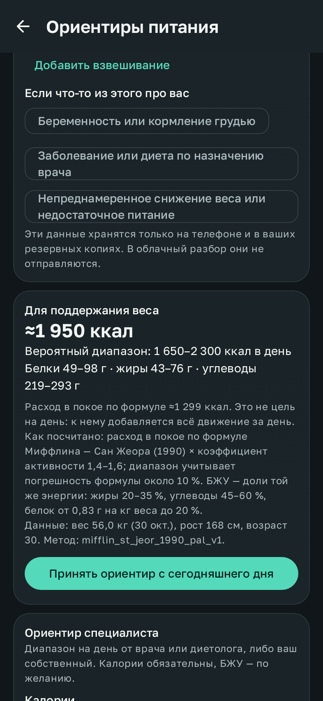

# Ориентиры питания

«Профиль → Ориентиры питания» задаёт диапазон калорий и БЖУ на день. С ним сравниваются ваши полные дни. Ориентир — это диапазон для сравнения, а не назначение. Приложение не ставит диагнозы, и ориентир врача или диетолога всегда важнее. Дневник, график и наблюдения работают и без ориентиров.

## Цель

| Цель | Что делает приложение |
| --- | --- |
| Поддерживать вес | Считает стартовый ориентир по формуле (ниже), если она подходит. Ориентир специалиста можно ввести всегда. |
| Менять вес | План снижения или набора веса не рассчитывается: для этого нужна отдельная проверка специалистом. Можно ввести ориентир, который дал специалист. |
| Только наблюдать | Калорийных ориентиров нет. |

## Расчёт для поддержания веса

1. **Расход в покое** считается по формуле Миффлина — Сан Жеора (1990): 10 × вес (кг) + 6,25 × рост (см) − 5 × возраст + 5 (мужской вариант) или − 161 (женский). Если пол для формулы не указан, берутся оба варианта, и диапазон получается шире. Расход в покое показан отдельно и подписан: это не цель на день.
2. **Коэффициент активности** задаётся диапазоном:

   | Активность | Коэффициент |
   | --- | --- |
   | Низкая | 1,4–1,6 |
   | Средняя | 1,6–1,8 |
   | Высокая | 1,8–2,1 |

   «Сожжённые калории» из часов или телефона к коэффициенту не добавляются, чтобы движение не учитывалось дважды.
3. **Диапазон**:
   - нижняя граница — меньший расход в покое × нижний коэффициент − 10 % (типичная погрешность формулы);
   - верхняя граница — больший расход в покое × верхний коэффициент + 10 %;
   - вероятное значение — середина;
   - всё округляется до 50 ккал.

   Пример: 30 лет, 168 см, 56 кг, женский вариант, низкая активность. Расход в покое ≈1 300 ккал. Ориентир ≈1 950 ккал, вероятный диапазон 1 650–2 300 ккал.
4. **БЖУ** считаются от вероятного значения калорий:
   - жиры 20–35 % энергии;
   - углеводы 45–60 % энергии;
   - белок от 0,83 г на кг веса (но не меньше 10 % энергии) до 20 % энергии.

   Так три диапазона согласованы между собой: их можно выполнить одновременно в пределах калорий, что проверяет тест по 4/9/4 ккал на грамм. Это референсные доли для населения (EFSA), а не индивидуальное назначение.

Под результатом показаны метод и его версия (`mifflin_st_jeor_1990_pal_v1`), вес с датой взвешивания, рост, возраст и пол для формулы. Целевой вес из профиля в расчёте не используется.

### Когда формула не предлагается

| Ситуация | Почему |
| --- | --- |
| Младше 18 лет | Формула и диапазоны рассчитаны на взрослых. |
| Старше 80 лет | Формулу проверяли на людях 19–78 лет. |
| Индекс массы тела ниже 18,5 | При недостатке веса расчёт по формуле не подходит. Сам индекс на экране не показывается. |
| Беременность или кормление грудью | Потребности меняются, формула их не учитывает. |
| Заболевание или диета по назначению врача | Ориентиром служит назначение специалиста. |
| Непреднамеренное снижение веса или недостаточное питание | Автоматический ориентир не рассчитывается: дефицит в такой ситуации предлагать нельзя, а поддержание надо обсуждать с врачом. |

Во всех этих случаях остаются дневник, график, наблюдения и ручной ориентир специалиста.

### Каких данных не хватает

Для расчёта нужны рост, год рождения, уровень активности и взвешивание из дневника веса не старше 30 дней. Если чего-то нет, экран так и пишет («не хватает свежего взвешивания»). Ничего не подставляется само.

## Ориентир специалиста

Калории задаются диапазоном «от – до», белки, жиры и углеводы по желанию (каждый только целиком, «от» и «до»). Можно указать, откуда ориентир. Если нижние границы БЖУ по 4/9/4 дают больше верхней границы калорий (или верхние меньше нижней) с запасом 10 % на этикетки, появляется предупреждение. Сохранить всё равно можно: это решение специалиста.

## История

Каждый ориентир начинает действовать с дня сохранения и действует до следующего. «Без калорийных ориентиров» тоже сохраняется как запись с датой. Повторное сохранение в тот же день заменяет только сегодняшний ориентир, прошлые дни сохраняют свой. Формула не пересчитывается сама: если вес, возраст или активность изменились, экран показывает новый результат рядом с действующим, и обновить ориентир можно только вручную.

## Где виден ориентир

- **График «Калории и БЖУ»**: полоса диапазона за каждым днём, у каждого дня свой ориентир. Под средним показан текущий ориентир и сравнение «Полные дни с ориентиром: в диапазоне 3, ниже 1, выше 0». Сравниваются только полные дни. Неполный, неотмеченный или сегодняшний день не называется ни «ниже», ни «выше».
- **Дневник питания**: в карточке «Сегодня» показана строка «Ориентир на день: 1 650–2 300 ккал». Это диапазон, а не «осталось съесть».

## Данные

- Цель, год рождения, пол для формулы, активность и особые обстоятельства хранятся в настройках на телефоне и входят в резервную копию. История ориентиров хранится в базе (версия 5, таблица `intake_plans`), входит в резервную копию и JSON-выгрузку (`intakePlans`) и стирается вместе с дневником.
- В облачный разбор не отправляется ничего из этого: ни ориентиры, ни особые обстоятельства.

## Проверка

- `MaintenanceGuidelineTest` проверяет:
  - формулу;
  - диапазон с погрешностью, что он не меньше расхода в покое, и пример выше;
  - согласованность БЖУ и нижнюю границу белка;
  - более широкий диапазон без пола;
  - все причины, по которым формула не предлагается;
  - недостающие и устаревшие данные;
  - проверку ручного ориентира по 4/9/4;
  - что каждый день сравнивается со своим ориентиром и только полные дни.
- `NutritionMigrationTest` проверяет переход базы 4→5 и что повторное сохранение в тот же день не трогает прошлые дни.
- `IntakePlanUiTest` в настоящем приложении проверяет:
  - расчёт по введённым данным, принятие ориентира и его основу;
  - что при беременности формула не предлагается;
  - предупреждение о несогласованных БЖУ;
  - ориентир специалиста, заменяющий сегодняшний.
- `IntakeUiTest` проверяет полосу ориентира и сравнение полных дней на графике.

Формула описана в [исходном исследовании](https://pubmed.ncbi.nlm.nih.gov/2305711/), референсные значения — у [EFSA](https://www.efsa.europa.eu/en/topics/topic/dietary-reference-values). Методика версионирована. Перед тем как полагаться на ориентир, его стоит обсудить со специалистом.
