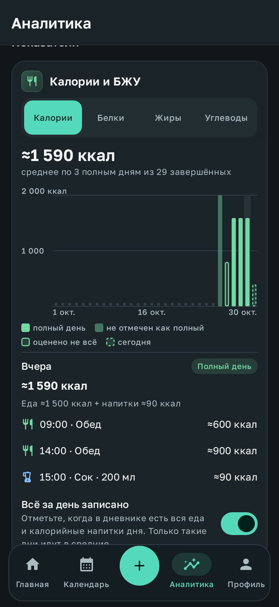
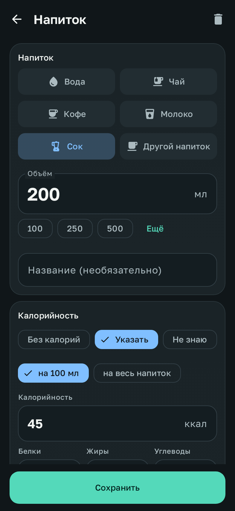

# Калории за день: напитки, полные дни и график

Итог дня складывается из еды и калорийных напитков. Каждая запись учитывается один раз. Неизвестное значение остаётся неизвестным. Средние считаются только по дням, которые можно честно назвать потреблением за день.

## Калорийность напитков

В редакторе напитка есть раздел «Калорийность»:

| Выбор | Что значит |
| --- | --- |
| Без калорий | Чай или кофе без добавок, вода. День из-за такого напитка неполным не становится. |
| Указать | Ккал и при желании Б/Ж/У. Можно указать **на 100 мл**, как на этикетке (тогда значение растёт с объёмом), или **на весь напиток**: например, ложка сахара не удваивается от большой кружки. |
| Не знаю | Калорийность неизвестна. День с таким напитком считается оценённым не полностью. |

Примерные значения подставляются одним нажатием: молоко 1,5 / 2,5 / 3,2 %, кефир, сок, сладкая газировка, капучино, какао, ложка сахара. Это средние значения, точнее всего данные с этикетки.

Что выбрано заранее:

- Вода всегда без калорий, указывать ничего не нужно.
- Новый чай и кофе начинаются с «Без калорий». Выбор виден в редакторе и меняется одним нажатием. Быстрое добавление чая и кофе тоже записывает «Без калорий».
- Молоко, сок и «другой напиток» начинаются с «Не знаю».
- Шаблон напитка хранит свою калорийность и передаёт её каждой записи из шаблона.
- Напитки и шаблоны, записанные до версии 1.9.0, сохраняют неизвестную калорийность. Старый кофе не считается кофе без молока. Откройте шаблон один раз и выберите нужный вариант.

В списке напитков рядом с объёмом показано «≈90 ккал» или «ккал не указаны». Для воды и напитков без калорий там ничего не пишется.

## Напиток к приёму пищи

Напиток можно привязать к приёму пищи того же дня («К приёму пищи» в редакторе напитка). Приём пищи показывает привязанные напитки в разделе «Напитки к этому приёму». Там же кнопка «Добавить напиток к приёму» открывает новый напиток со временем приёма.

Напиток остаётся отдельной записью: его объём идёт в жидкость, а калории в итог дня. В итог самого приёма пищи они не добавляются, поэтому ничего не считается дважды. Если тот же напиток уже записан блюдом (например, компот на фото обеда), удалите одно из двух. Приложение напоминает об этом рядом с привязанными напитками. Если напиток перенести на другой день, привязка снимается. После удаления приёма с отменой привязка возвращается вместе с приёмом.

## Итог дня

Итог дня считает одно место в коде, `DayIntake`. Дневник, график, наблюдения и экспорт берут цифры оттуда.

- В итог идут приёмы пищи и напитки, которые могут нести калории. Вода и напитки без калорий не учитываются.
- Каждый показатель (ккал, белки, жиры, углеводы) имеет своё покрытие: калории могут быть известны у всех записей, а жиры только у части.
- Если значение есть не у всех записей, итог подписан «известно ≈1 200 ккал». Рядом стоит «Оценено 3 из 4 записей: итог неполный». В «известно» входит и известная часть приёма с частично оценёнными блюдами, поэтому сумма совпадает с тем, что видно в дневнике.
- Если калории есть и у еды, и у напитков, показано, из чего сложился итог: «Еда ≈1 500 ккал + напитки ≈90 ккал».

## Полный день

Оценки по записям не равны всему, что было съедено. Если один приём забыли записать, сумма остальных не является потреблением за день. Поэтому есть отметка **«Всё за день записано»**. Её ставит сам пользователь: в карточке «Сегодня» дневника питания, переключателем «всё записано» у прошлых дней и в составе дня на графике.

У дня одно из состояний:

| Состояние | Когда |
| --- | --- |
| Полный день | День закончился, отмечен «всё записано», у каждого приёма и калорийного напитка есть значение. |
| Не отмечен как полный | Всё оценено, но отметки нет. |
| Оценено не всё | У какой-то записи нет значения. |
| Сегодня, день ещё идёт | Текущий день не входит в завершённые средние, даже если отмечен. |
| Нет записей | Ни еды, ни калорийных напитков. Это неизвестность, а не ноль. |

Отметка говорит только о полноте записей, не о точности: оценка по фото остаётся оценкой.

## График «Калории и БЖУ»

В «Аналитике» над остальными показателями есть карточка с периодами 7/14/30/90 дней и своим интервалом. Переключатель выбирает ккал, белки, жиры или углеводы. Разные единицы на одной шкале не смешиваются.

- Столбец на каждый день. Полный день закрашен. Не отмеченный как полный закрашен светлее. Оценённый не полностью показан контуром. Сегодня обведено пунктиром. День без записей отмечен точкой у оси, а не нулевым столбцом. Пропуски ничем не соединяются.
- Над графиком среднее только по полным завершённым дням и их число: «среднее по 5 полным дням из 29 завершённых». Если таких дней нет, так и написано, и объяснено, как они появляются.
- Нажатие на столбец открывает состав дня: каждый приём и напиток со своим значением (или «не указано»), состояние дня и переключатель «Всё за день записано». Запись открывается нажатием. Для ккал при известных Б/Ж/У показана грубая проверка «Из БЖУ ≈… ккал» по 4/9/4 ккал на грамм.

Ориентиров по калориям пока нет. Они появятся на следующем этапе, вместе с профилем, и будут храниться с датой начала действия.

## Наблюдения

Наблюдения «Питание по полным дням» и «Сон и питание» считаются только по полным дням (минимум 5 дней; для сна и питания 7 пар «день + ночь»). Напитки с калориями входят и в среднее, и в долю калорий после 18:00. В облачный разбор этот факт передаётся как `complete_days` (контракт версии 4). Ограничение данных в обзоре за 4 недели называет, сколько полных дней есть среди дней с едой, и предлагает отмечать такие дни.

## База, резервная копия и экспорт

База обновляется до версии 4 миграцией 3→4: у напитков и шаблонов появляется калорийность (пустая у прежних записей), у напитков появляется связь с приёмом, добавлена таблица отмеченных дней. Всё это входит в резервную копию и стирается вместе с дневником.

В CSV-архиве у `drinks.csv` есть колонки `energy` (none / value / unknown), ккал и Б/Ж/У этого напитка, `entered_per` и `meal_id`. Новый `days.csv` содержит по строке на каждый день периода: состояние, отметку, число записей, известную сумму и сколько записей оценено по каждому показателю. В JSON-выгрузке у напитков есть `nutrition` и `mealId`, а список `daysRecordedFully` содержит отмеченные дни.

## Проверка

- `DayIntakeTest` проверяет:
  - еду и сок, сложенные один раз, без воды и чая без калорий;
  - что неизвестный напиток не превращается в ноль;
  - известную часть частично оценённого приёма;
  - все состояния дня и отдельное покрытие каждого показателя;
  - значения на 100 мл и на весь напиток;
  - средние только по полным дням и пустые дни как пропуски.
- `InsightEngineTest` проверяет, что дни с неоценённым приёмом или без отметки не дают «Питания по полным дням», и что напитки входят в среднее и в вечернюю долю.
- `DrinkEditorSafetyTest` проверяет выбор по типу, сохранение выбранного значения при смене типа, блокировку сохранения при недописанном числе, открытие старого напитка как неизвестного и привязку к приёму с её снятием при переносе на другой день.
- `NutritionMigrationTest` проверяет базу версии 3: старый кофе и шаблон остаются неизвестными, новые значения, привязка и отметки дней сохраняются.
- `IntakeUiTest` в настоящем приложении проверяет среднее по трём полным дням, состав неполного и полного дня, снятие отметки и переход к напитку.

