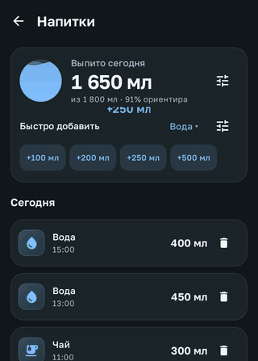
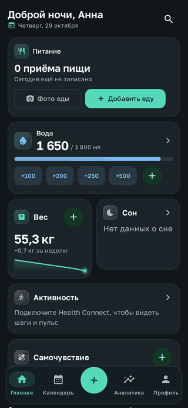
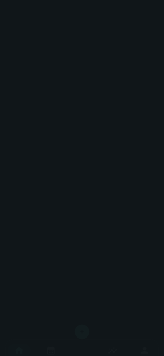

# Анимации и эффекты

Движение в Nutrix подсказывает, что произошло: куда ушёл экран, что изменилось и сработало ли нажатие. Все длительности и кривые собраны в `NutrixMotion` (`core/ui/motion/Motion.kt`): 150 мс для мелких реакций, 300 мс для переходов, кривые Material 3 «emphasized» и мягкие пружины для отклика на касание.

| Ориентир по воде | Лист быстрого добавления | Запуск главной |
| --- | --- | --- |
|  |  |  |

Кадры записаны в Robolectric пошаговыми часами Compose, по 40 мс на кадр, на демонстрационных данных. Это не запись с телефона.

## Где что движется

| Место | Что видно |
| --- | --- |
| Навигация | Вкладки сменяются через затухание с лёгким увеличением. Вложенные экраны сдвигаются по общей горизонтальной оси: вперёд вправо, назад влево. Нижняя панель и кнопка «+» уезжают при переходе в подробный экран и возвращаются на главные вкладки. Иконка выбранной вкладки коротко «подпрыгивает». |
| Кнопка «+» | Поворачивается в «×», пока открыт лист быстрого добавления. Пункты листа появляются каскадом. |
| Карточки | Кликабельные карточки, пункты листа и быстрые действия слегка сжимаются при нажатии и пружинят обратно. |
| Главная | Карточки появляются каскадом после загрузки данных, поэтому пустые состояния не мелькают перед настоящими значениями. Если загрузка задерживается, каскад всё равно начинается через 0,4 с. Каскад проигрывается один раз: при возврате из редактора экран не анимируется заново. |
| Вода | Сумма плавно досчитывает до нового значения. После быстрого добавления над карточкой поднимается «+250 мл». На экране напитков «стакан» с волной наполняется до доли от ориентира. При достижении ориентира появляется отметка «Ориентир достигнут», лёгкий салют и тактильный отклик. |
| Списки | Новые записи напитков, еды, симптомов, веса, сна и тренировок плавно занимают место, удалённые уходят без скачка. Запись напитка можно смахнуть влево для удаления, после чего доступна обычная отмена. Кнопка удаления в строке осталась. |
| Графики | Спарклайн веса прорисовывается слева направо. Столбики мини-графика вырастают по очереди, выбранный столбик подсвечивается плавно. |
| Переключатели | Выделение в переключателях периода скользит между вариантами. Выбор на шкале 0–5 и в календаре отмечается пружинящей ячейкой. Чипы плавно меняют ширину, когда появляется галочка. |
| Календарь | Сетка месяца сдвигается в сторону перелистывания, название месяца сменяется по вертикали. |
| Распознавание фото | Вместо отдельного индикатора по анализируемому фото проходит полоса «сканирования». Галочка успешного заполнения появляется с пружиной. |
| Блокировка | Точки PIN увеличиваются при вводе цифры. Неверный PIN встряхивает строку точек и окрашивает их в цвет ошибки. |
| Пустые состояния | Иллюстрация медленно покачивается. |

## Доступность

- Если в настройках Android включено «Удалить анимацию», Compose сокращает переходы до мгновенных. Декоративные эффекты (волна, салют, всплывающие подписи, покачивание, сканирование) при этом не запускаются вовсе: `rememberReducedMotion()` читает системный масштаб анимаций.
- Всплывающие подписи и салют скрыты от TalkBack. Результат действия по-прежнему сообщают текст на экране и snackbar.
- Смахивание лишь ускоряет удаление. Видимая кнопка удаления и отмена остались.
- Салют срабатывает только после собственного добавления пользователя, которое перешло ориентир. Загрузка данных, синхронизация и повторные добавления после ориентира его не вызывают. Ориентир остаётся ориентиром, а не «нормой»: тексты и логика ориентира не менялись.

## Проверка

`MotionLogicTest` проверяет, когда срабатывает празднование и что всплывающих подписей не больше четырёх. `WaterInteractionTest` проходит в настоящем приложении путь «быстро добавить → достичь ориентира → смахнуть запись», проверяет удаление в Room и предложение отмены. Бесконечные анимации в тестах Compose отключены, остальные переходы доигрываются тестовыми часами до снимков `ScreenshotTest`. Плавность на устройстве по статическим снимкам не проверяется.
